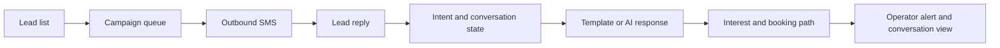
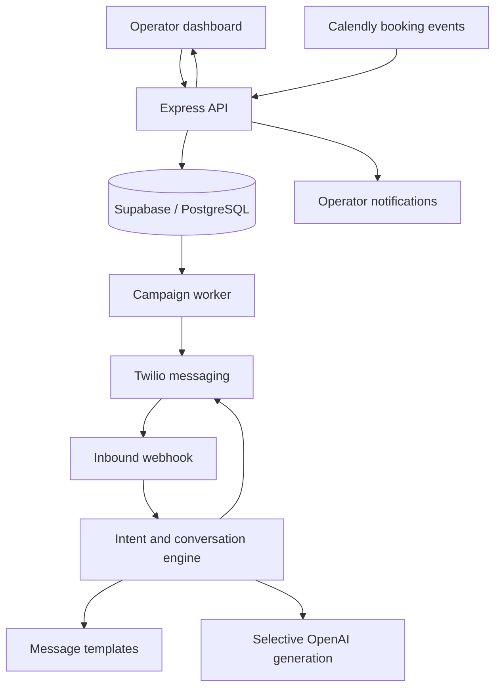

# AI SMS Outbound & Lead Engagement System — Case Study

### Connecting outbound outreach, lead conversations, and booked calls

I built an SMS outreach and lead engagement application for a confidential client in real-estate recruiting. The system combines campaign management, a hybrid AI and rules conversation engine, booking integration, and an operator dashboard.

Its purpose is to help a business work through lead lists, maintain short and relevant conversations, and bring staff into the opportunities that need personal attention.

**My work:** Backend development, conversation logic, messaging and scheduling integrations, campaign processing, dashboard features, and automated tests.

**Stack:** Node.js · Express · JavaScript · HTML/CSS · Twilio · OpenAI · Supabase/PostgreSQL · Calendly · Vercel configuration

> This repository contains a public case study. The client implementation, identity, business documents, message scripts, and operational data remain private.

## The business problem

The client needed to start conversations with prospective recruits and move suitable prospects toward an introductory call. Sending an initial message was only the beginning: the business also needed to understand replies, handle questions, recognize interest, and know when a person had booked.

The project brief identified problems with an earlier automation approach: long AI responses, repeated replies to short acknowledgments, message-length costs, fragmented scheduling, and difficulty working through larger lead lists.

The product challenge was to connect outreach and follow-up in a workflow the business could manage without a developer editing every campaign.

## How the system addresses it

| Business challenge | What I built | Intended business value |
| --- | --- | --- |
| Working through contact lists one number at a time | CSV input, duplicate removal, and database-backed campaign jobs | Reduce repetitive campaign preparation and sending work |
| Overly long or unpredictable bot replies | Intent routing, reusable templates, selective AI generation, and character limits | Keep common responses consistent and messaging more concise |
| Repeated responses that ignore the conversation | Stored message history and history-aware routing | Give the system context for its next response |
| Losing interested prospects among other replies | Lead statuses, interest alerts, and conversation views | Help staff identify conversations that deserve attention |
| Disconnect between a booking link and the lead who booked | Per-lead booking links and calendar webhook matching | Connect scheduling events back to the outreach pipeline |
| Changing campaign copy requires developer work | Dashboard template editing and optional message variants | Give operators control over routine messaging changes |
| Little visibility after launching outreach | Campaign progress, lead filters, conversation history, and analytics views | Make outreach activity easier to inspect and manage |

These benefits describe the product's intended value. Revenue gains, booking uplift, and cost savings are not quantified in this case study.

## From a lead list to a business conversation

1. **Prepare outreach:** An operator imports a CSV or enters phone numbers and chooses campaign copy.
2. **Queue the campaign:** The backend creates a persistent job and message queue. The worker processes pending messages in batches.
3. **Receive a reply:** The messaging provider sends the inbound message to the backend.
4. **Choose a response:** Conversation logic examines intent, lead status, and message history. Common paths use templates; selected conversations use AI.
5. **Surface interest:** The system updates the lead's status and can alert the operator.
6. **Connect a booking:** A tracked calendar link helps associate a booked call with the lead.
7. **Continue personally:** Staff can review the thread and send manual replies. The engine suppresses automatic replies for leads already marked as booked.

## Why combine rules with AI?

Many replies need a predictable action: identify the business, acknowledge a refusal, answer a common question, or offer a booking link. Sending every message through a language model adds variability where a defined response may be more useful.

I separated conversation control from response generation. The rules layer handles intent and state transitions, while AI supports selected replies that benefit from conversation context. Template fallbacks let those paths return a defined response when generation fails.

This design aims to make the workflow more controllable and limit unnecessary model calls. Actual model usage and cost reduction would need measurement under real campaigns.

## What the operator can manage

- Single-message sending and bulk campaign input.
- Campaign progress, sent/failed counts, and pause, resume, and cancel controls.
- Leads organized by engagement and booking status.
- Conversation history and manual replies.
- Template editing, resets, and optional A/B message variants.
- Booking and opt-out views, including opt-out export.
- Aggregate messaging and lead-status metrics.
- Dashboard event updates with a polling fallback.

## Architecture

The application keeps campaign state and message history in the database. The dashboard gives staff a working interface over those records, while the backend connects conversation decisions, messaging, and booking events.

[Explore the engineering decisions →](docs/architecture.md)

## Validation and project scope

The archived snapshot passed **62 existing unit tests**, JavaScript syntax checks, and syntax checks for both dashboard scripts. The tests cover areas including intent detection, conversation routing, campaign controls, CSV parsing, authentication helpers, template variants, and booking identifiers.

This is a case study of the implementation work. It does not claim measured production throughput, a verified conversion improvement, or regulatory certification. Live campaign results and client operational records are not published.

[Read the evidence and evaluation scope →](docs/evaluation.md)

## What this project demonstrates

This project connects AI integration to a concrete business process: moving from contact lists to conversations that staff can act on. The engineering work spans application interfaces, persistent jobs, external webhooks, stateful conversation logic, and human intervention.

The central product decision is to let automation handle repetitive steps while keeping campaign visibility and conversation tools available to the business.

## Resume summary

> Built a full stack SMS outbound and lead engagement system using Node.js, Twilio, OpenAI, and Supabase, integrating campaign queues, hybrid conversation routing, tracked bookings, operator alerts, and an outreach dashboard.

**Portfolio link:** [AI SMS Outbound & Lead Engagement — Case Study](https://github.com/AhmadTariq-4090/ai-sms-outbound-lead-engagement-case-study)

## Confidentiality

This repository contains newly written documentation and conceptual diagrams only. No client source code, exact prompts or scripts, branding, contact lists, credentials, or original business documents are included. [Publication boundaries →](docs/publication-boundaries.md)
